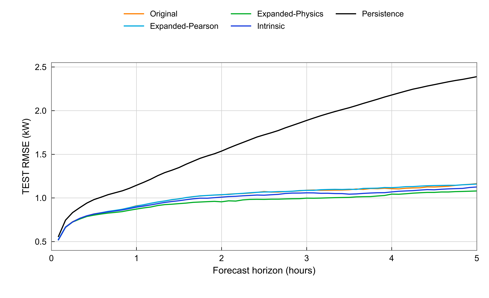
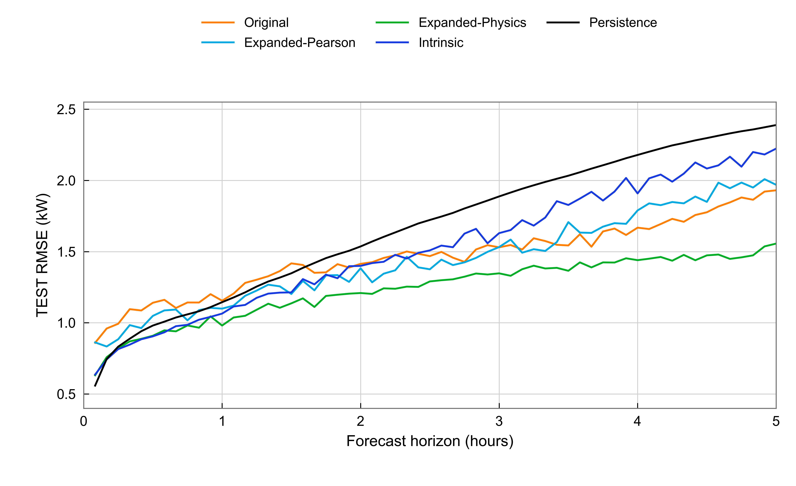
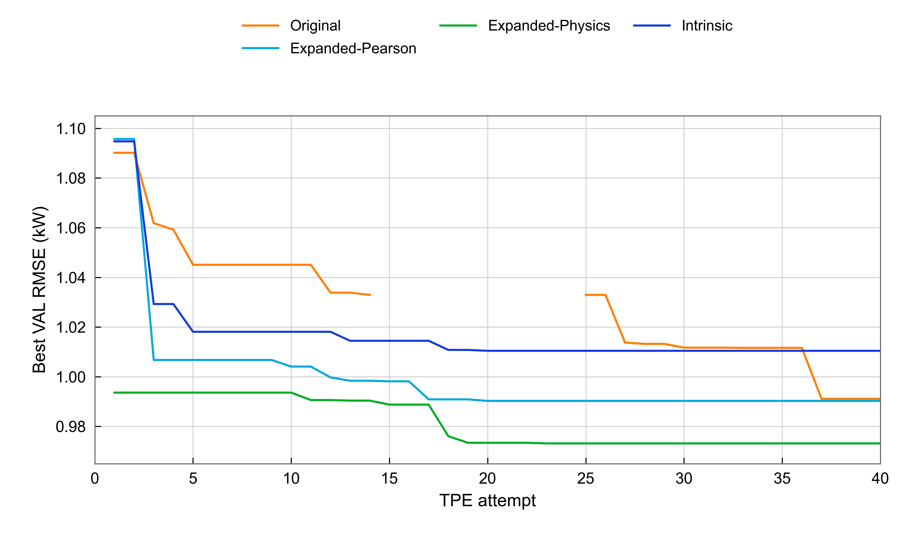
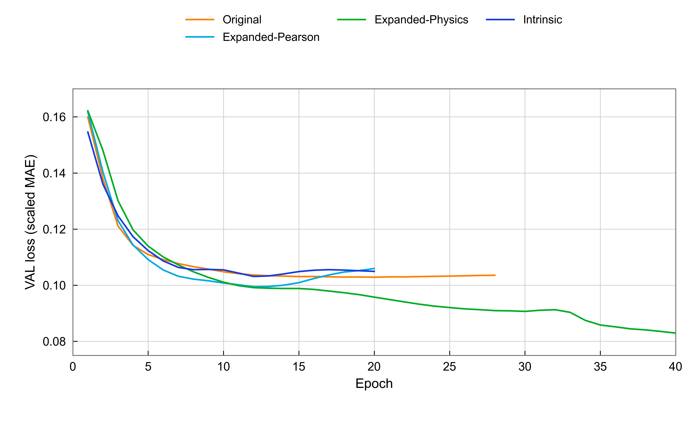
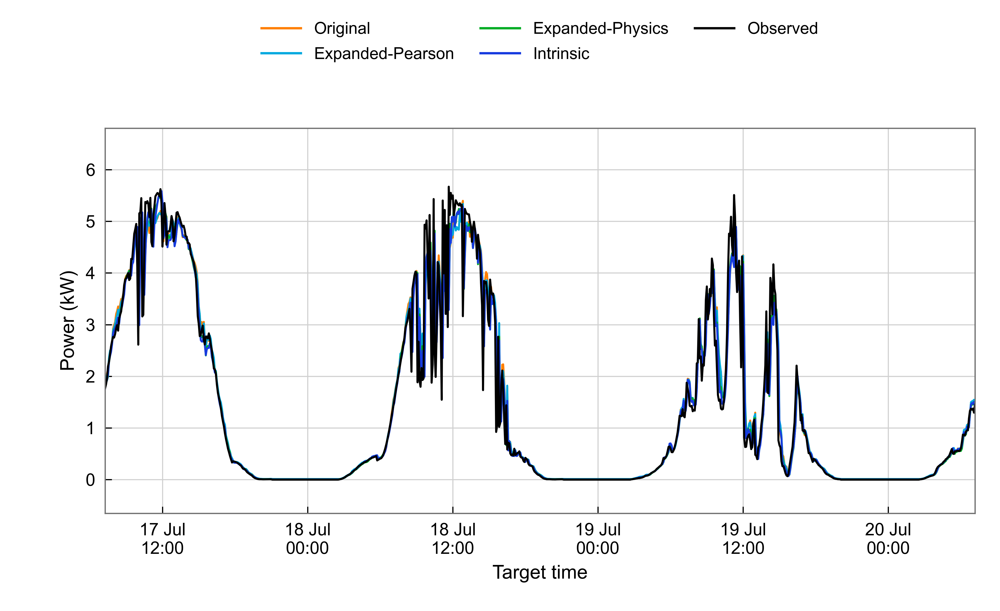
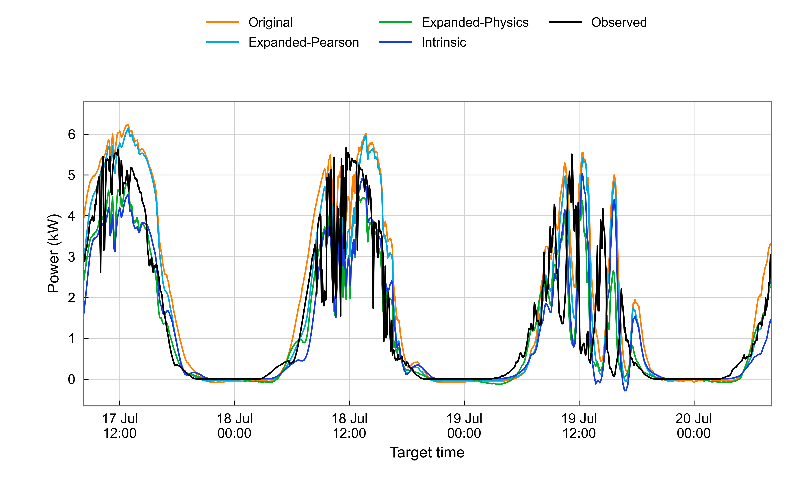

# PhysPV

**Physics guided feature space design for photovoltaic power forecasting.**

[](https://www.python.org/)
[](LICENSE)
[](https://creativecommons.org/licenses/by/4.0/)

PhysPV treats feature selection as a physics problem, not a purely statistical one. Physics
defines the candidate search space and a bounded Optuna TPE search jointly
selects the feature subset, look-back window and model hyperparameters. The repository
compares four independently optimized feature spaces for XGBoost and CNN_LSTM on the
[SOLETE](https://doi.org/10.11583/DTU.17040767) benchmark, with Persistence as the forecast
baseline.

## Background

Short-term PV forecasting supports grid balancing, energy trading and battery dispatch. Yet
adding more inputs does not always improve accuracy. Redundant features enlarge the search
space without adding information. PhysPV asks whether physics domain knowledge can guide the
design of compact, meaningful feature spaces, and whether the resulting gains transfer across
model architectures. 

## Models

Two complementary model families:

- XGBoost is an efficient gradient boosted tree model for the nonlinear relationships
  between weather, physical features and PV power, the same family behind
  [Open Climate Fix's Quartz Solar](https://github.com/openclimatefix/open-source-quartz-solar-forecast).
- CNN_LSTM is a hybrid sequence model that combines convolutional feature extraction with
  LSTM temporal modeling, as evaluated in a
  [2026 PV forecasting benchmark](https://doi.org/10.1007/s00521-026-12335-1).

Together they test whether physics guided feature selection transfers across model families.

## Data

SOLETE measurements are sorted onto a five-minute timeline, with samples spanning data gaps
excluded. Irradiance, air temperature, wind speed and equipment parameters provide estimates
of module temperature, cell temperature, DC power (`Pdc`) and AC power (`Pac`), alongside
time-of-day features. For the available-power task, measured power is replaced by `Pac` when
`Pac` exceeds 0.05 kW and their difference exceeds 20% of `Pac`. The corrected series serves
as both input power history and forecast target; raw measurements are retained for sensitivity
checks. Night observations remain in the input history, while primary evaluation scores
include only daylight targets.

## Experiment design


Every space includes the corrected power history described above. Their optional inputs:

| Space | Optional inputs |
| --- | --- |
| Original | Temperature, humidity, wind speed/direction, GHI, POA |
| Expanded-Pearson | Expanded candidates with TRAIN \|Pearson r\| ≥ 0.70; humidity retained |
| Expanded-Physics | Humidity, POA, Pac, TempCell, HoursOfDay |
| Intrinsic | None |

The protocol uses five-minute data, a 60-step forecast horizon (five hours), and a
chronological 70/20/10 TRAIN/VAL/TEST split. The look-back window spans up to 120 time
steps (10 hours), giving at most 121 observations including the current time.

Scaling and Pearson selection are fitted on TRAIN only. Each feature space is optimized
independently, with configurations selected by mean per-horizon daylight VAL RMSE. Each
space's winner is then frozen and evaluated once on TEST, using common forecast origins
across spaces.

## Results

TEST RMSE (kW) is calculated against the physically corrected target at each of the 60
forecast horizons using only daylight target timestamps, then averaged across horizons:

| Space | XGBoost (kW) | CNN_LSTM (kW) |
| --- | ---: | ---: |
| Persistence (baseline) | 1.6791 | 1.6791 |
| Original | 1.0151 | 1.4615 |
| Expanded-Pearson | 1.0184 | 1.4433 |
| **Expanded-Physics** | **0.9536** | **1.2383** |
| Intrinsic | 0.9888 | 1.5249 |

Expanded-Physics lowers RMSE versus each study's Original space by **6.06 %** (XGBoost)
and **15.27 %** (CNN_LSTM).

<table width="100%">
  <tr>
    <th width="50%">XGBoost</th>
    <th width="50%">CNN_LSTM</th>
  </tr>
  <tr>
    <td align="center"></td>
    <td align="center"></td>
  </tr>
  <tr>
    <td align="center"></td>
    <td align="center"></td>
  </tr>
  <tr>
    <td align="center"></td>
    <td align="center"></td>
  </tr>
</table>

The figure rows show:

- Top: daylight TEST RMSE at each of the 60 forecast horizons.
- Middle: VAL RMSE (kW) by TPE attempt for XGBoost, and scaled VAL MAE by epoch for CNN_LSTM.
- Bottom: predictions over the first TEST days, at a five-minute lead for XGBoost and a
  one-hour lead for CNN_LSTM. Black curves show the physically corrected target.

### One-hour forecast example


Observed is raw measured power. The three dates were selected by measured-power variability,
independently of forecast errors. Lower strips show |Physics error| − |Original error|: green
favors Physics, orange favors Original.

## Quick start

Requires Python 3.9. Install dependencies, place `SOLETE_Pombo_5min.h5` in `data/raw/`, and
configure the study in [config.yaml](config/config.yaml) and [plant.yaml](config/plant.yaml).

```bash
python -m pip install -r requirements.txt
python main.py prepare
python main.py train --resume "outputs/results/<study_id>/manifest.json"
python main.py evaluate --resume "outputs/results/<study_id>/manifest.json"
python main.py report --resume "outputs/results/<study_id>/manifest.json"
```

Replace `<study_id>` with the ID printed by `prepare`, then reuse that manifest for the
remaining stages. Run the tests with `python -m unittest discover -s tests`. Tests use
synthetic inputs and never run training experiments.

## License

Code and documentation: [MIT](LICENSE), © 2026 Felix Lan. SOLETE data:
[CC BY 4.0](https://creativecommons.org/licenses/by/4.0/). Third-party materials retain their
respective licenses.
