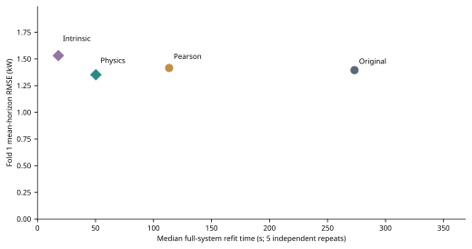
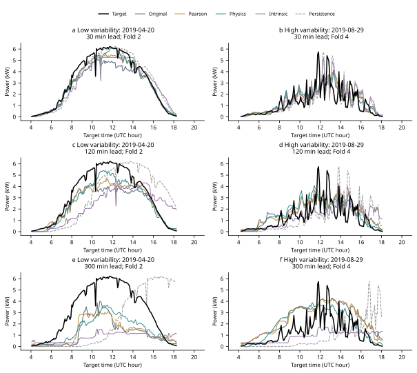

# PhysPV — Physics-Guided Feature-Space Search for PV Forecasting

A reproducible ML engineering case study of **accuracy and computational cost** in five-hour PV forecasting. Meteorological inputs, history length and model settings jointly affect both. PhysPV compares independently optimized XGBoost systems using four candidate feature spaces and a Persistence baseline.

**Question:** Can a physics-guided feature space identify more accurate and less expensive forecasting configurations than correlation-based screening?

## Dataset

[SOLETE](https://doi.org/10.11583/DTU.17040767) contains observations from Denmark, June 2018–September 2019. This case uses five-minute measurements and predicts 60 steps (five hours). The existing target includes physics-guided power correction; reported scores describe that corrected target. Sensor QC preserves time gaps and does not interpolate. See [cleaning rules](eda/cleaning_workflow.md).

The raw HDF5 and full model/prediction archive remain local. A checkout includes static historical result tables and figures.

## Methodology


Pearson screening and initial scaling fit TRAIN only. TPE jointly selects inputs, PRE and XGBoost settings by mean horizon VAL RMSE. Frozen winners are refit on expanding historical data without future evaluation inputs. Five identical-seed Fold 1 refits measure resource variation; predeclared repeat 1 supplies predictions. Paired calendar-block bootstrap evaluates temporal uncertainty.

| Space | Candidate inputs |
| --- | --- |
| Original | Measured operational/weather variables |
| Expanded-Pearson | Expanded pool screened by TRAIN correlation |
| Expanded-Physics | Predeclared physically relevant, nonredundant pool |
| Intrinsic | Target history only as forecast input |

Exact pools, selected features and dates: [methodology](docs/methodology.md).

## Results

Recorded XGBoost results; RMSE is the equal-weight mean across four folds, each scored by the mean of 60 daylight horizon RMSEs. Resources are Fold 1 medians over five refits. MiB uses 2²⁰ bytes.

| Space | Four-fold RMSE (kW) | Refit (s) | Process RAM (MiB) | Model (MiB) | Predictor p95 (ms) |
| --- | ---: | ---: | ---: | ---: | ---: |
| Original | 1.1762 | 273.24 | 1156.62 | 130.89 | 668.07 |
| Expanded-Pearson | 1.1797 | 113.46 | 905.84 | 57.80 | 520.93 |
| Expanded-Physics | **1.1360** | **50.31** | **675.13** | **15.77** | **387.25** |
| Intrinsic | 1.5159 | 17.96 | 497.18 | 9.98 | 352.68 |

Sources: [temporal scores](assets/case_study/tables/table_05_temporal_statistics.csv), [resources](assets/case_study/tables/table_04_computational.csv).



*This plot compares Fold 1 error with median time over five refits. The table above
reports four-fold average error; search cost is separate.*

Physics versus Pearson has **3.71% lower observed RMSE** and **55.66% lower median refit time**. Its selected PRE is 60 versus 100; flattened input dimensions are 183 versus 303. These systems differ in features, history and model settings; this comparison does not isolate an individual feature's causal effect.

Refit time is not search cost. Physics search time is an incomplete lower bound because an interrupted attempt lacks complete timing. Predictor latency excludes scaling, feature generation and loading; a separate supplement includes input/output scaling. Full tables, horizon performance and scope: [results](docs/results.md).



*Forecasts at 30, 120 and 300 minute leads, aligned by target time. Black is the
physics-corrected target. Days were selected by target variability, not prediction
error; these illustrative examples do not represent every period.*

## Limitations

One installation, one TPE search seed, a corrected target and four future periods limit generalization. Fixed-seed repeats measure resource variation, not search uncertainty. Intrinsic still depends on weather in shared preprocessing. A [conditional AWS cost estimate](docs/results.md#conditional-aws-compute-cost-estimate) applies real pricing to assumed durations; cloud bills, electricity consumption, sensor saving and production deployment were not validated. See [limitations](#limitations).

## Run the project

The active code follows one path: **data preparation → training → evaluation**.
Use Python **3.9** and put `SOLETE_Pombo_5min.h5` in `data/raw/`.

```bash
python -m pip install -r requirements.txt
python main.py prepare --config config/config.yaml
python main.py train --resume outputs/results/<new-study-id>/manifest.json --model XGBoost
python main.py evaluate --resume outputs/results/<new-study-id>/manifest.json
```

Use the new study ID printed by `prepare`. Training jointly searches features, PRE
and model settings using bounded Optuna TPE, then freezes the winners. Evaluation
writes `metrics.csv` and `predictions.csv` under the same result directory. It does
not launch repeated resource benchmarks, statistical inference or figure builders.
The saved manifest keeps settings, source and run status so outputs remain identifiable.

Explore the data in [one EDA notebook](eda/solete_eda.ipynb). It reuses the same
loading/cleaning functions, displays TRAIN statistics and QC changes, and does not
export another dataset or train models. Optional Jupyter/ipykernel installation is
needed to open it. Tests: `python -m unittest discover -s tests`.

**The results above are historical case evidence.** The current three-stage run
uses the configured TRAIN/VAL/TEST split; it does not reconstruct the historical
four-fold evaluation, resource benchmarks or cloud-cost scenarios. Existing graphs
and tables are retained for presentation. See [run instructions](docs/reproducibility.md)
and [historical results](docs/results.md).

## Project structure

| Path | Responsibility |
| --- | --- |
| `main.py` | Three commands: prepare, train, evaluate |
| `config/` | Data, plant, search and model settings |
| `src/data.py`, `cleaning.py` | Time grid, QC, physical features, splits and windows |
| `src/models.py` | Existing XGBoost and CNN_LSTM model implementations |
| `src/experiments.py` | Preparation, bounded TPE, frozen-winner evaluation and run records |
| `src/evaluate.py` | Forecast metrics, prediction exports and consolidated result tables |
| `src/config.py`, `runtime.py` | Configuration, paths, GPU/runtime setup and training measurements |
| `eda/solete_eda.ipynb` | Guided data exploration using core functions |
| `assets/case_study/`, `docs/results.md` | Static historical case results and figures |
| `outputs/` | Local data/model/run outputs and historical source archives; excluded from Git |
| `tests/` | Core data, model-interface and workflow checks |

## References

- Pombo, Gehrke & Bindner. [SOLETE dataset paper](https://doi.org/10.1016/j.dib.2022.108046).
- [Archived bibliography](assets/case_study/references.bib), including Pombo's physics-informed PV studies.
- Chen & Guestrin. [XGBoost](https://doi.org/10.1145/2939672.2939785).
- Akiba et al. [Optuna](https://doi.org/10.1145/3292500.3330701).
- Hewamalage, Ackermann & Bergmeir. [Forecast evaluation: common pitfalls and best practices](https://doi.org/10.1007/s10618-022-00894-5).

Code and documentation: [MIT](LICENSE). SOLETE: [CC BY 4.0](https://creativecommons.org/licenses/by/4.0/); retain attribution when sharing derived data.
