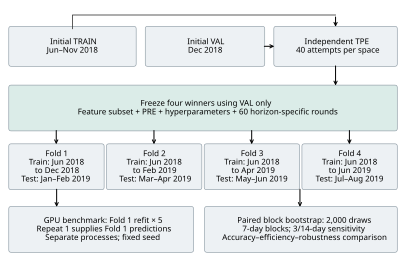
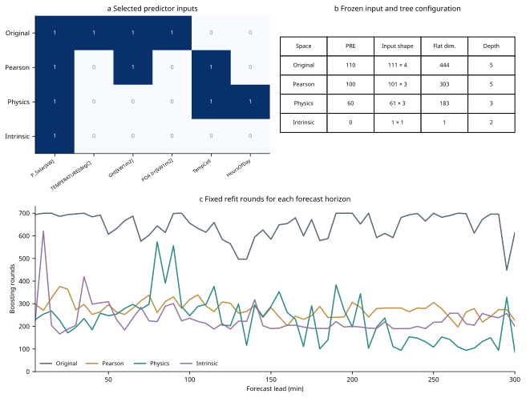
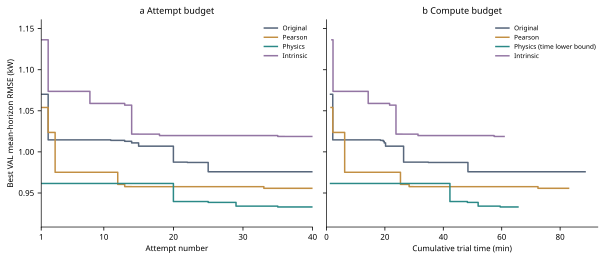

# Methodology

The active pipeline handles preparation, bounded TRAIN/VAL training and TEST
evaluation. The forward folds, resource repeats and statistical inference below
describe the historical case study, whose outputs are retained as static evidence.
They are not rerun by the current CLI.

Selection uses the initial TRAIN/VAL interval. All later folds reuse the frozen
features, history length, hyperparameters and horizon-specific boosting rounds.

## Data flow and feature spaces

`load_data` sorts the five-minute grid, rejects duplicate/off-grid timestamps and keeps missing rows. Optional fixed sensor QC is separate from the established `correct_power` target construction. `pv_power_features` constructs Pac, Pdc, TempModule and TempCell; time supplies MinutesOfDay and HoursOfDay.

`prepare_spaces` fits Pearson screening on initial TRAIN only. Exact candidate pools and nonredundancy restrictions live in `src/data.py`; winning inputs are recorded in [table_02_configurations.csv](../assets/case_study/tables/table_02_configurations.csv).

Original offers air temperature, humidity, wind speed/direction, GHI and POA in
addition to mandatory power history. Expanded-Pearson screens those six plus
Pac/Pdc/TempModule/TempCell/MinutesOfDay/HoursOfDay at absolute correlation ≥0.7,
with humidity explicitly retained by configuration. Expanded-Physics offers
humidity, POA, Pac, TempCell and HoursOfDay, plus power history. It omits redundant
power/temperature/time representations before TPE subset selection.

| Winner | Selected inputs | PRE | Input shape | Flattened size |
| --- | --- | ---: | --- | ---: |
| Original | Power, air temperature, GHI, POA | 110 | 111 × 4 | 444 |
| Expanded-Pearson | Power, GHI, TempCell | 100 | 101 × 3 | 303 |
| Expanded-Physics | Power, TempCell, HoursOfDay | 60 | 61 × 3 | 183 |
| Intrinsic | Power | 0 | 1 × 1 | 1 |

PRE counts preceding intervals; histories include the current observation. Feature subset, PRE and model hyperparameters are jointly optimized independently for each space. Forty attempts include failures/interruptions. There is no additional seed search. The interruption and continuation remain recorded.

The matrix records predictor inputs, not every raw sensor needed for preprocessing.
The curves show fixed boosting rounds (`best_iteration + 1`) for each horizon.
Features, history and tree settings vary together; this does not isolate a causal
effect of individual features on resource use.

## Selection and forward evaluation

All dates are half-open UTC intervals. Initial TRAIN is June–November 2018; VAL is December 2018. Selection minimizes the arithmetic mean of 60 horizon VAL RMSEs. Freeze features, history, hyperparameters and each horizon's `best_iteration + 1` before refitting. Pearson is not reselected.

Each curve tracks best-so-far **validation** error, not future test performance.
Failed/interrupted trials consume budget. Physics elapsed time is an incomplete
lower bound; preparation/coordinator overhead and the supplemental replay are
excluded. Search time is distinct from frozen-model refitting time.

| Fold | Historical fitting interval | Future target interval |
| --- | --- | --- |
| 1 | Jun–Dec 2018 | Jan–Feb 2019 |
| 2 | Jun 2018–Feb 2019 | Mar–Apr 2019 |
| 3 | Jun 2018–Apr 2019 | May–Jun 2019 |
| 4 | Jun 2018–Jun 2019 | Jul–Aug 2019 |

Refit scalers on each fold's historical TRAIN only. No validation/future arrays enter fixed-round fitting. Inputs use t−PRE through t; labels use t+1 through t+60 and remain inside their partition. Spaces share eligible origins and a maximum-history guard. Earlier observations may provide context; windows cannot jump over missing grid rows.

## Metrics, resources and statistics

Primary fold score: mean of sixty daylight horizon RMSEs in kW. Four-fold summary: equal-weight mean of fold scores. Pooled RMSE is separate. nRMSE uses the recorded 10 kW AC normalization, not the 7.2 kW module rating.

Fold 1 has five isolated fixed-seed refits per space; predeclared repeat 1 provides predictions. Later folds have one refit per space, totaling 32 fits. Measurements include fitting, sampled process RAM/device VRAM, complete serialized forecaster size and synchronized single-origin 60-step inference. Main inference excludes scaling; the supplement includes input and inverse target scaling. Neither includes acquisition, feature construction or networking.

Paired bootstrap keeps horizons/spaces together within an origin-day and resamples moving calendar blocks within each fold: 2,000 draws, seven-day primary blocks and three-/fourteen-day sensitivity. Holm correction covers three space-vs-Original comparisons. Physics-vs-Pearson is secondary. This uncertainty is conditional on the observed task and frozen search, not uncertainty over TPE seeds.

## Active code

`main.py` exposes only `prepare`, `train` and `evaluate`. Data/QC, model fitting,
metrics, configuration and essential run records remain in `src/`. Peripheral
analysis, statistical inference, independent auditing and plotting code is archived
outside the active source tree. See [run instructions](reproducibility.md).
