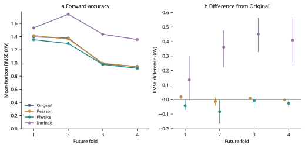
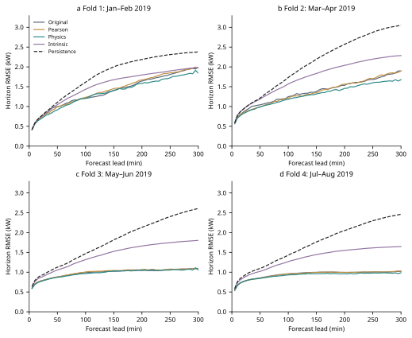
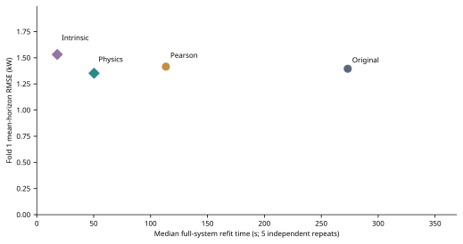
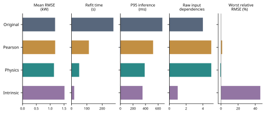
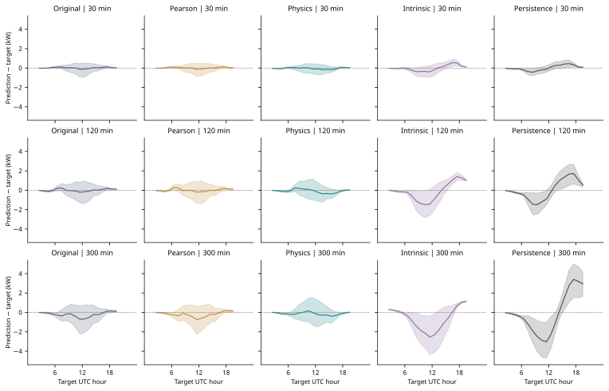
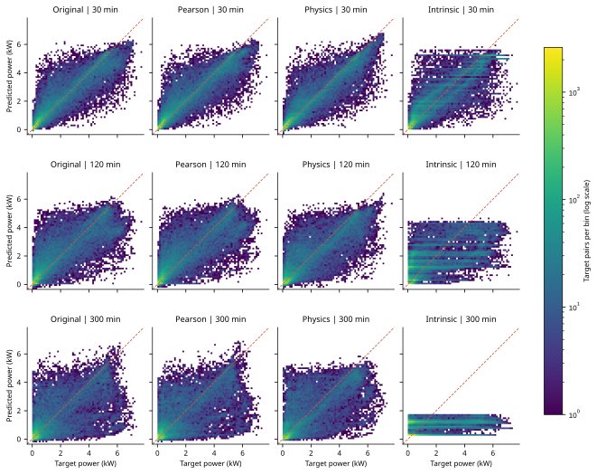

# Historical case results

These are recorded conclusions from an earlier experimental workflow. The current
prepare/train/evaluate code does not regenerate four-fold statistics, resource
benchmarks or these figures. Their static values and source data are retained.

Source: `outputs/research_v2/experiments/manifest.json`. Portable copies in `assets/case_study/` retain recorded values and figure data. The older `report/main.pdf` describes an earlier protocol.

## Forward accuracy

| Space | Jan–Feb | Mar–Apr | May–Jun | Jul–Aug | Equal-fold mean |
| --- | ---: | ---: | ---: | ---: | ---: |
| Original | 1.3954 | 1.3784 | 0.9847 | 0.9465 | 1.1762 |
| Expanded-Pearson | 1.4153 | 1.3653 | 0.9944 | 0.9440 | 1.1797 |
| Expanded-Physics | 1.3523 | 1.2951 | 0.9766 | 0.9202 | 1.1360 |
| Intrinsic | 1.5318 | 1.7396 | 1.4366 | 1.3556 | 1.5159 |

Units: kW; each fold averages sixty daylight horizon RMSEs. [Full temporal table](../assets/case_study/tables/table_05_temporal_statistics.csv). Physics is lower than Pearson in all four folds; the equal-fold reduction is 3.71% from unrounded values (approximately 3.70%).



The left panel shows period-specific scores; the right shows paired differences
against Original with seven-day block-bootstrap intervals. Effects vary by period;
fold-specific intervals are descriptive. The primary inference uses the equal-fold
endpoint with its declared multiplicity correction.



Each panel shows one forward fold over 5–300 minute leads, with common axis scales.
All four folds' horizon values: [horizon_metrics.csv](../assets/case_study/tables/horizon_metrics.csv). Persistence and scored-target counts: [fold_metrics.csv](../assets/case_study/tables/fold_metrics.csv).

## Computational trade-off

The README gives median resources. Full medians/IQRs, search duration, memory scope and predictor p50/p95: [table_04_computational.csv](../assets/case_study/tables/table_04_computational.csv). Physics-versus-Pearson refitting falls from 113.46 to 50.31 seconds (55.66%). This is fixed-round fitting, not optimization time.



The accuracy axis above is **Fold 1**, not the four-fold mean. Each point is a different optimized system. Intrinsic trades lower computational requirements for worse accuracy.



The saved-model supplement covers prepared unscaled input → scaling → sixty GPU regressors → inverse target scaling. Median p95 is 537.44 ms for Pearson and 422.61 ms for Physics. [Supplementary latency table](../assets/case_study/tables/table_07_physical_unit_inference.csv). A separate measurement session cannot isolate scaling overhead.

## Conditional AWS compute-cost estimate

Using the AWS public price feed checked on **2026-11-12**, the selected scenario is
**EC2 g4dn.xlarge, Linux, shared On-Demand, us-east-1 (N. Virginia), USD 0.526/hour**.
This instance has an NVIDIA T4, four vCPUs and 16 GiB RAM. The recorded local
benchmark instead used an RTX 5070 Ti Laptop GPU: this is a tariff-based scenario,
not a measured cloud runtime, actual bill or validated cloud deployment.

Sources: [official price feed](https://b0.p.awsstatic.com/pricing/2.0/meteredUnitMaps/ec2/USD/current/ec2-ondemand-without-sec-sel/US%20East%20%28N.%20Virginia%29/Linux/index.json),
[instance specifications](https://aws.amazon.com/ec2/instance-types/g4/) and
[AWS billing rules](https://docs.aws.amazon.com/AWSEC2/latest/UserGuide/ec2-on-demand-instances.html).
The selected rate code, check date and assumptions are preserved in
[`cloud_cost_assumptions.json`](../assets/case_study/cloud_cost_assumptions.json).

Assume one fixed-configuration refit per independently started session, with the
instance stopped immediately after the modeled work. Use the existing Fold 1
median fitting times, 113.4637 s for Pearson and 50.3105 s for Physics, as assumed
cloud durations. AWS charges per second with a 60-second session minimum:

```text
billed seconds = max(60, ceil(assumed cloud fit seconds + billed nonfit seconds))
compute USD = billed seconds / 3600 × 0.526
```

| Scenario | Pearson USD | Physics USD | Estimated saving USD | Reduction |
| --- | ---: | ---: | ---: | ---: |
| One session, fitting only | 0.016657 | 0.008767 | 0.007890 | 47.37% |
| 30 sessions/month, fitting only | 0.499700 | 0.263000 | 0.236700 | 47.37% |
| 720 sessions/month, fitting only | 11.992800 | 6.312000 | 5.680800 | 47.37% |
| One session, plus assumed 300 s billed nonfit work | 0.060490 | 0.051285 | 0.009205 | 15.22% |
| 30 sessions/month, plus assumed 300 s/session | 1.814700 | 1.538550 | 0.276150 | 15.22% |
| 720 sessions/month, plus assumed 300 s/session | 43.552800 | 36.925200 | 6.627600 | 15.22% |

The 300 seconds are a sensitivity assumption for running-state initialization,
data preparation and artifact handling, not a measured startup delay. AWS pending
time is not counted here. Monthly scenarios repeat the same workload; they do not
predict growing-data fitting times or demonstrate that hourly retraining is needed.

The 60-second minimum reduces the fitting-only percentage saving below the 55.66%
local duration reduction. An always-running instance costs USD 383.98 per 730-hour
month in this tariff scenario for either model: faster fitting alone does not
reduce that instance bill. These estimates exclude storage, transfer, public IPv4,
tax, paid software, initial TPE, inference serving and model-specific preparation
differences. Lower sampled memory is not evidence that either model can use a
cheaper instance; both scenarios use the same instance size.

The cost calculator is historical supporting analysis, outside the active CLI.
Its source is preserved at
`outputs/research_v2/archive/20261115_src_consolidation/tools/case_study.py`.
Restore the original source layout in a separate checkout if recalculation is needed.
The recorded output remains in
[`cloud_cost_scenarios.csv`](../assets/case_study/tables/cloud_cost_scenarios.csv)
for all four spaces, including assumed common cloud/local duration multipliers of
1, 2 and 4. These multipliers are sensitivity cases, not calibrated GPU speed
ratios; the two models may have different cloud/local speed changes. Cloud fitting
times must be measured before claiming a cloud cost advantage. The 3.71% accuracy
difference remains historical forecast evidence, not a newly validated cloud result.

## Interpretation and uncertainty

The evidence supports the observed accuracy/resource trade-off of the selected physics-guided system. Features, history and hyperparameters differ; no individual-feature causal attribution follows.

[Statistical comparisons](../assets/case_study/tables/table_06_statistical_comparisons.csv) include paired block-bootstrap intervals, sensitivity and multiplicity adjustment. The primary family compares alternatives against Original; Physics-versus-Pearson is secondary. An interval crossing zero does not establish equivalence. Fixed-seed resource repeats do not quantify search uncertainty.

## Error diagnostics

The [README prediction examples](../README.md#results) show low- and high-variability
days at 30, 120 and 300 minute leads. They were selected using target variability
alone, not favorable forecast errors. Black denotes the corrected target, not the
untouched meter observations. [Curve data](../assets/case_study/tables/case_prediction_curves.csv)
and [candidate days](../assets/case_study/tables/case_day_candidates.csv) preserve the
recorded examples; they are illustrative post-study diagnostics.



Lines show mean prediction minus corrected target; positive values indicate
overprediction. Shading is the empirical 25th–75th percentile range, **not a
confidence interval**. The plot pools eligible daylight target pairs across folds;
hourly counts and seasonal composition differ. See the
[hourly summary](../assets/case_study/tables/diurnal_error_summary.csv).



Panels share axes, bins and a logarithmic count scale. The dashed line is y=x;
white bins contain no observations. Counts pool four folds' daylight pairs and do
not represent independent samples. This descriptive view shows error concentration,
not statistical equivalence. [Recorded bin counts](../assets/case_study/tables/prediction_density_counts.npz).
